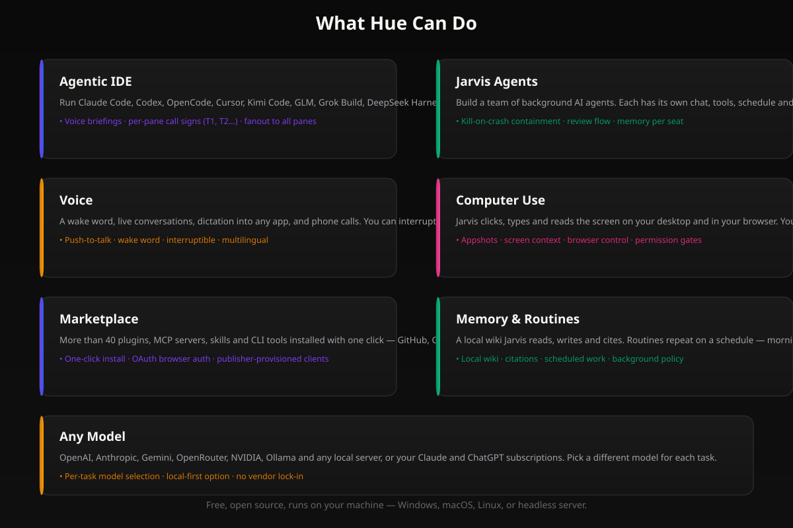

<h1 align="center">Hue</h1>

<p align="center">
  <strong>The open-source AI agent super-app for your desktop.</strong><br />
  Run every coding agent side by side, talk to your computer, and keep a team of AI agents working while you are away.
</p>

<p align="center">
  <a href="https://github.com/tbwcheatwood-hue/Hue/blob/main/LICENSE"></a>
  <a href="https://github.com/tbwcheatwood-hue/Hue/actions/workflows/ci.yml"></a>
  <a href="https://discord.gg/x7USduHxbc"></a>
</p>

<p align="center">
  <a href="#quick-start">Quick Start</a> ·
  <a href="#features">Features</a> ·
  <a href="https://github.com/tbwcheatwood-hue/Hue/tree/main/docs">Docs</a> ·
  <a href="https://discord.gg/x7USduHxbc">Discord</a>
</p>

<p align="center">
  
  <br/><sub>Hue architecture — core engine, Agentic IDE, Jarvis Agents, Voice, Computer Use, Marketplace and Memory.</sub>
</p>

---

Hue is one desktop app for everything AI can do on a computer. It has a workspace where several coding agents run side by side, AI agents that keep their own memory, a voice assistant with a wake word, control of your desktop and browser, and a plugin marketplace. It works with the models you already pay for, whether hosted, local or through a subscription you have.

You say what you want. Hue answers you, does the task on your computer, or hands it to the agent that fits, and you can watch every step.

It is free and open source, and it runs on your own machine. You do not need an account, and there is no cloud of ours between you and your models. It runs on Windows, macOS and Linux, and as a server without a screen.

## Quick Start

<p align="center">
  
  <br/><sub>Install → Launch → Connect your model key.</sub>
</p>

**Install from source**

```bash
git clone https://github.com/tbwcheatwood-hue/Hue.git
cd Hue
pip install -e . --no-deps
pip install -r requirements.txt
cp jarvis.toml.example jarvis.toml
cp .env.example .env   # if an example exists
```

**Launch**

```bash
# Headless server (works on any machine, no display needed)
jarvis serve          # opens at http://localhost:8442

# Full desktop app (Windows / macOS / Linux with a display)
jarvis                # or double-click the Hue desktop shortcut
```

On Linux without GTK/pywebview, `jarvis serve` runs headless and you open the printed address in your browser. A `~/.local/share/applications/personal-jarvis.desktop` shortcut plus `~/.local/bin/jarvis-launch` wrapper are installed so Hue appears in your application menu.

**Connect a model**

Open **API Keys & Providers** in the app and add your OpenAI, Anthropic, Gemini, OpenRouter, NVIDIA, Ollama or other key. Credentials stay in your OS credential store — never in config files. You need one API key, a subscription, or a local model; a microphone helps for voice but is optional. You do not need a GPU.

## Features

<p align="center">
  
</p>

| | |
|---|---|
| **Agentic IDE** | Run Claude Code, Codex, OpenCode, Cursor, Kimi Code, GLM, Grok Build, DeepSeek Harness, Kilo Code and Zed Code side by side in live terminal panes. You can brief them by voice. |
| **Jarvis Agents** | Build a team of AI agents that stay around. Each one has its own chat, instructions, tools, schedule and memory, and learns from its own work. |
| **Voice** | A wake word, live conversations, dictation into any app, and phone calls. You can interrupt it mid-sentence. |
| **Computer use** | Hue clicks, types and reads the screen on your desktop and in your browser. You decide what it may do. |
| **Marketplace** | More than 40 plugins, MCP servers, skills and command-line tools you install with one click, including GitHub, Google Workspace, Notion, Slack, Linear, Spotify and Home Assistant. |
| **Any model** | OpenAI, Anthropic, Gemini, OpenRouter, NVIDIA, Ollama and any local server, or your Claude and ChatGPT subscriptions. Pick a different one for each task. |
| **Memory** | A local wiki that Hue reads, writes and cites, so it remembers context across chats, agents and days. |
| **Routines** | Work that repeats on a schedule, such as a morning briefing, an inbox sweep or a nightly report. |
| **Appshots** | Press two keys to show Hue the window you are looking at, or just one area of it. |
| **Pets** | A small animated companion on your desktop that reacts while Hue listens, thinks and talks. |

## Run every coding agent at once

The Agentic IDE turns one screen into a room full of coding agents. You open a project, split the screen into panes, and give each pane its own coding agent. Every pane gets a short call sign such as T1 or T2, so you can steer them without touching the keyboard. You might say "Tell T1 to write the tests", "What is T2 working on?" or "Send the fix plan to all panes".

- Hue finds the coding tools you already have installed and starts any of them in a pane with one key. You keep using the subscriptions you pay for.
- You can send the same task to several panes and compare what comes back.
- You can talk to Hue while the agents type, and it passes your brief to the right pane by its call sign.
- Every pane is a real terminal, so you can type into it yourself at any time.

### Coding agent support matrix

| Agent | Binary | Enable key | Status |
|---|---|---|---|
| Claude Code | `claude` | `CLAUDE_API_KEY` / sign-in | Built-in |
| Codex | `codex` | `CODEX_API_KEY` / sign-in | Built-in |
| OpenCode | `opencode` | sign-in | Built-in |
| Cursor CLI | `agent` / `cursor-agent` | `CURSOR_API_KEY` / `agent login` | Built-in |
| Kimi Code | `kimi` | sign-in | Built-in |
| GLM | `glm` | `ZAI_API_KEY` | Built-in |
| Grok Build | `grok` | sign-in | Built-in |
| Antigravity | `agy` | API Keys page | Built-in |
| DeepSeek Harness | `deepseek-harness` | API Keys page | Built-in |
| **Kilo Code** | `kilo-code` | `KILOCODE_API_KEY` | Registered — placeholder binary/install URL; degrades safely until confirmed against a live install |
| **Zed Code** | `z-code` | `ZCODE_API_KEY` | Registered — placeholder binary/install URL; degrades safely until confirmed against a live install |

Kilo Code and Zed Code are registered in `jarvis/workspace/agents.py` but their binary names, install URLs and CLI flags are placeholders that must be confirmed against a live install before they will spawn. The entries degrade safely: `spawn_env_factory` returns `None` when the API key is unset, so no pane can start talking to the wrong vendor. Set `KILOCODE_API_KEY` or `ZCODE_API_KEY` on the API Keys page to enable. Remove them by deleting the registry entry (reversible — no data migration).

Read more in the [Agentic IDE guide](https://github.com/tbwcheatwood-hue/Hue/blob/main/docs/product/extend-and-automate/agentic-ide.md).

## A team of agents that keeps working

Hue Agents are specialists you create with one click and keep for as long as you like: a researcher, a release manager, a marketing writer, or whatever your work needs.

- Each agent has one chat that never ends, so tomorrow you continue where you stopped today.
- Agents keep private notes on what they learned from their own work, and they get better at your tasks over time.
- Give an agent a routine and it does the work on schedule, without being asked.
- Files, reports and plans they produce land in Artifacts, and you can see every tool they used along the way.
- Longer coding missions run in their own copy of your repository (a git worktree), can split into parallel workers, and pass a review before you see the result.

Read more in the [Agents guide](https://github.com/tbwcheatwood-hue/Hue/blob/main/docs/product/extend-and-automate/jarvis-agents.md) and [routines](https://github.com/tbwcheatwood-hue/Hue/blob/main/docs/routines.md).

## Talk to your computer

You pick your own wake phrase, such as "Hey Nova", "Jarvis" or anything else, and then you talk.

- Conversations are live and take turns naturally. Mid-sentence you can ask it to open a website, check your calendar or start an agent.
- Dictation types what you say into any app and learns your words from a personal dictionary.
- Phone calls go through your own number. You can call Hue, or let it call someone for you once you approve.
- Speech recognition and voices can run fully offline. Hosted voices are optional.

Read more in the [voice guide](https://github.com/tbwcheatwood-hue/Hue/blob/main/docs/product/everyday-use/voice-conversations.md) and the [dictation guide](https://github.com/tbwcheatwood-hue/Hue/blob/main/docs/product/everyday-use/dictation.md).

## Connect your tools

- Install plugins from the marketplace with one sign-in in your browser, or add any MCP server yourself.
- Hue finds command-line tools such as GitHub, Vercel, Supabase, Stripe, Docker and the cloud CLIs, and signs you in to them from the app.
- Skills are reusable instructions that Hue picks up when your request fits one.
- You can reach Hue from Telegram and Discord.
- The `jarvis` command and a local API give your own scripts, and other agents, the same control you have.

Read more about [plugins](https://github.com/tbwcheatwood-hue/Hue/blob/main/docs/product/extend-and-automate/plugins.md), [MCP](https://github.com/tbwcheatwood-hue/Hue/blob/main/docs/product/extend-and-automate/mcp-connections.md), [command-line tools](https://github.com/tbwcheatwood-hue/Hue/blob/main/docs/product/extend-and-automate/cli-connections.md) and the [Hue CLI](https://github.com/tbwcheatwood-hue/Hue/blob/main/docs/jarvis-cli.md).

## You stay in control

Every action Hue takes passes a risk check with four levels: safe, monitor, ask and block. Anything that could change your system waits for your approval, and every run is recorded, so you can see later exactly what happened. Your keys are kept in your operating system's credential store. Nothing leaves your machine unless you connect a service that needs it.

Read more about [safety and approvals](https://github.com/tbwcheatwood-hue/Hue/blob/main/docs/product/privacy-safety-and-support/safety-and-approvals.md) and [privacy and local data](https://github.com/tbwcheatwood-hue/Hue/blob/main/docs/product/privacy-safety-and-support/privacy-and-local-data.md).

## Desktop shortcut

A `personal-jarvis.desktop` file is installed to `~/.local/share/applications/` so Hue appears in your desktop application menu. On Linux hosts without GTK/pywebview it launches the headless server (`jarvis serve`) and opens it in your browser; on hosts with a graphical desktop it launches the full app. A `~/.local/bin/jarvis-launch` wrapper handles the fallback.

## Docs

- **Getting started:** [quick start](https://github.com/tbwcheatwood-hue/Hue/blob/main/docs/product/start-here/first-run-setup.md), [app tour](https://github.com/tbwcheatwood-hue/Hue/blob/main/docs/product/start-here/desktop-app-tour.md)
- **Everyday use:** [voice](https://github.com/tbwcheatwood-hue/Hue/blob/main/docs/product/everyday-use/voice-conversations.md), [dictation](https://github.com/tbwcheatwood-hue/Hue/blob/main/docs/product/everyday-use/dictation.md), [memory](https://github.com/tbwcheatwood-hue/Hue/blob/main/docs/product/knowledge-and-sharing/wiki-and-memory.md)
- **Agents and automation:** [agentic IDE](https://github.com/tbwcheatwood-hue/Hue/blob/main/docs/product/extend-and-automate/agentic-ide.md), [agents](https://github.com/tbwcheatwood-hue/Hue/blob/main/docs/product/extend-and-automate/jarvis-agents.md), [computer use](https://github.com/tbwcheatwood-hue/Hue/blob/main/docs/product/extend-and-automate/computer-use.md), [plugins](https://github.com/tbwcheatwood-hue/Hue/blob/main/docs/product/extend-and-automate/plugins.md), [MCP](https://github.com/tbwcheatwood-hue/Hue/blob/main/docs/product/extend-and-automate/mcp-connections.md), [CLI](https://github.com/tbwcheatwood-hue/Hue/blob/main/docs/jarvis-cli.md)
- **Models:** [providers](https://github.com/tbwcheatwood-hue/Hue/blob/main/docs/product/personalize-and-connect/providers-and-api-keys.md), [local models](https://github.com/tbwcheatwood-hue/Hue/blob/main/docs/product/personalize-and-connect/local-ai-providers.md)
- **Running and fixing:** [server](https://github.com/tbwcheatwood-hue/Hue/blob/main/docs/headless-vps-deployment.md), [architecture](https://github.com/tbwcheatwood-hue/Hue/blob/main/docs/architecture-overview.md), [troubleshooting](https://github.com/tbwcheatwood-hue/Hue/blob/main/docs/product/privacy-safety-and-support/troubleshooting.md)

## Contribute

A good place to start is a [good first issue](https://github.com/tbwcheatwood-hue/Hue/issues?q=is%3Aissue+is%3Aopen+label%3A%22good+first+issue%22) and the guide to [your first contribution in 10 minutes](https://github.com/tbwcheatwood-hue/Hue/blob/main/CONTRIBUTING.md#your-first-contribution-in-10-minutes). Questions and ideas go to [discussions](https://github.com/tbwcheatwood-hue/Hue/discussions), and security reports follow [SECURITY.md](https://github.com/tbwcheatwood-hue/Hue/blob/main/SECURITY.md).

If you are an AI agent helping with this repository, read [`AGENTS.md`](https://github.com/tbwcheatwood-hue/Hue/blob/main/AGENTS.md) first.

If Hue is useful to you, a star on GitHub helps other people find it. Sponsors are listed in [SPONSORS.md](https://github.com/tbwcheatwood-hue/Hue/blob/main/SPONSORS.md).

<!-- contributors:start -->

<a href="https://github.com/rubenluetke10-beep"></a>

<!-- contributors:end -->

## License

[Apache 2.0](https://github.com/tbwcheatwood-hue/Hue/blob/main/LICENSE). Releases up to and including 1.6.0 keep their original MIT license. See [NOTICE](https://github.com/tbwcheatwood-hue/Hue/blob/main/NOTICE) and the [trademark guidance](https://github.com/tbwcheatwood-hue/Hue/blob/main/TRADEMARK.md).
